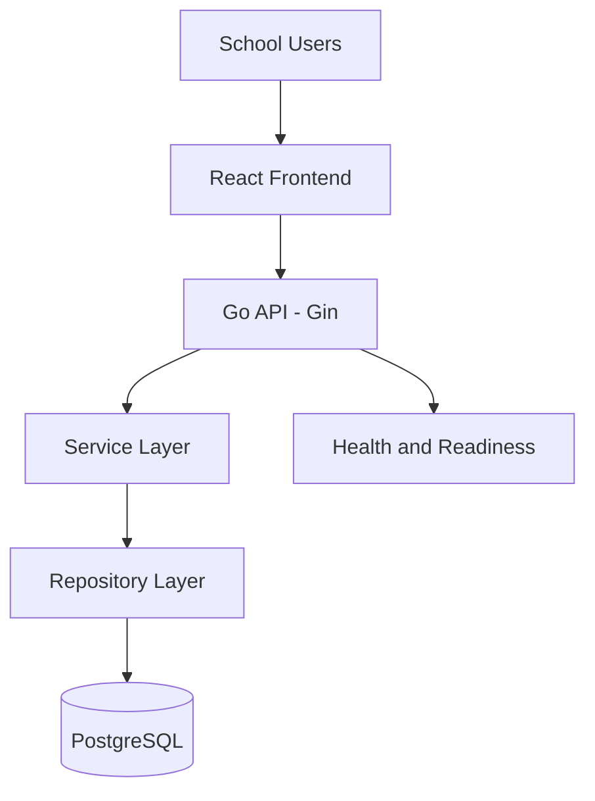

# System Architecture

## 1. Purpose

This document describes the architecture of the School Management System, its current implementation, and the planned direction for future development.

The system is intended to serve multiple schools through a shared application platform.

### Target scale

- 25–30 schools.
- Approximately 400–500 students per school.
- Approximately 10,000–15,000 students in total.

These figures are planning targets, not verified capacity or load-test results.

## 2. Technology Stack

| Layer | Technology | Status |
|---|---|---|
| Frontend | React, TypeScript, Vite | Planned |
| Backend | Go, Gin | Initial foundation implemented |
| Database | PostgreSQL | Implemented locally |
| Database connectivity | pgx connection pool | Implemented |
| Database migrations | Go migration command and SQL migration files | Implemented |
| Authentication | Password hashing and internal authentication service | Initial foundation implemented |
| JWT authentication | Access-token and refresh-token HTTP flow | Pending |
| Authorization | Role-based access control (RBAC) | Pending |
| Testing | Go tests and Go vet | Initial tests implemented |

## 3. High-Level Architecture

The planned system uses a React frontend, a Go/Gin API, and PostgreSQL.

This is a logical architecture diagram. It does not imply that all future layers and business modules are already implemented.

## 4. Architectural Style

The backend follows a modular-monolith direction.

A modular monolith keeps the application in one deployable backend while separating responsibilities into packages and modules.

This is the initial approach because the current target scale does not, by itself, require a microservices architecture.

### Benefits

- Simpler deployment and local development.
- Easier debugging for a small development team.
- Clear boundaries between HTTP handlers, business logic, and database access.
- Ability to scale the application without introducing distributed-system complexity too early.

Modules can be separated into independent services later if measured operational needs justify that change.

## 5. Backend Responsibilities

The backend uses Go and Gin.

### API and server layer

Location: `backend/cmd/api/`

Responsibilities include:

- Starting the HTTP server.
- Loading application configuration.
- Establishing database connectivity.
- Registering routes.
- Configuring HTTP server timeouts.
- Handling graceful shutdown.
- Exposing health and readiness checks.

### Configuration layer

Location: `backend/internal/config/`

Responsibilities include loading and validating application configuration.

Secrets and environment-specific values must not be hardcoded in source code.

### Database layer

Location: `backend/internal/database/`

Responsibilities include PostgreSQL connection-pool initialization and database connectivity.

### Models

Location: `backend/internal/models/`

Responsibilities include application data structures, such as the current user model.

Models must not expose sensitive fields, such as password hashes, in API JSON responses.

### Repository layer

Location: `backend/internal/repository/`

Responsibilities include database queries and persistence operations.

Repositories should use parameterized SQL queries and return errors that the service layer can handle safely.

### Service layer

Location: `backend/internal/services/`

Responsibilities include business rules and coordination between repositories.

The initial authentication service contains user-creation and credential-authentication logic. It is not yet a complete HTTP authentication system.

### Migrations

Location: `backend/migrations/`

Responsibilities include versioned database schema changes.

The migration command is located at `backend/cmd/migrate/`.

## 6. Request Flow

The intended flow for a business request is:

1. The client sends an HTTP request.
2. Gin matches the request to a route.
3. Authentication middleware validates the user's identity when the route is protected.
4. Authorization checks whether the user may perform the requested operation.
5. The service layer applies business rules.
6. The repository executes the required database operations.
7. The result returns through the service and HTTP layers.
8. The API sends an appropriate status code and response.

Steps involving authentication middleware, RBAC, and business endpoints are part of the planned architecture and are not all implemented yet.

## 7. Multi-School Architecture

### Initial strategy: shared database

The initial design uses a shared PostgreSQL database for multiple schools.

School-owned data must include a school relationship where appropriate. The backend must enforce the authorized school context in every relevant query and mutation.

A `school_id` field or database foreign key alone does not guarantee tenant isolation.

### Required tenant-isolation rules

- Every school-owned resource must be associated with the correct school.
- Authenticated requests must use a trusted server-side school context.
- Client-provided school identifiers must not grant access by themselves.
- Repository queries must restrict access to the authorized school.
- Related records must be checked for school ownership.
- Automated tests must verify that users cannot read or modify another school's data.

Tenant-isolation enforcement remains a required future implementation task.

### Separate database per school

A separate database for each school is not the initial strategy.

It would add operational work for connection management, migrations, monitoring, backup, restoration, and reporting across schools.

Revisit this decision only if concrete requirements justify a different isolation model.

## 8. Database Design

PostgreSQL is the primary relational database.

The schema should use:

- Primary keys for record identity.
- Foreign keys for valid relationships.
- Unique constraints for business rules.
- Check constraints for supported values.
- Appropriate indexes for frequent queries.
- Transactions for operations that must succeed or fail together.
- Timestamps where creation and update history is needed.

Relationships should be represented through normalized tables unless a documented requirement justifies another approach.

JSON/JSONB may be appropriate for genuinely flexible attributes, but it should not replace relational tables for core entities that need referential integrity, joins, and consistent querying.

The exact schema and migration history are documented in `DATABASE.md`.

## 9. Authentication and Authorization

The current authentication foundation includes:

- A `users` table associated with a school.
- Password hashing and verification using bcrypt.
- Service-level checks for school and user status.
- A `refresh_sessions` table for future refresh-session handling.

The following are not yet complete:

- HTTP registration and login routes.
- JWT issuance and validation.
- Refresh-token rotation and revocation flows.
- Authentication middleware.
- RBAC enforcement.
- Complete tenant-isolation enforcement.

These features must be implemented and tested before the system can be considered ready for real school users.

See `SECURITY.md` for security requirements.

## 10. Planned Functional Modules

The following are planned product areas, not a statement that their APIs or user interfaces already exist:

- School administration and configuration.
- User and role management.
- Students and parent relationships.
- Teachers and class assignments.
- Classes, sections, and subjects.
- Attendance.
- Timetable and academic scheduling.
- Student and parent dashboards.
- Transport and bus tracking.
- Notifications and reports.

Fee and payment functionality is outside the initial implementation scope unless explicitly added to the requirements later.

## 11. Reliability and Performance

The application currently has an initial HTTP server and PostgreSQL connection foundation.

Future production work should include:

- Query and index review.
- Pagination for large result sets.
- Appropriate connection-pool configuration.
- Request timeouts and graceful shutdown.
- Monitoring of errors, latency, database connections, and resource usage.
- Backup and restoration testing.
- Integration tests and load tests using realistic school data.

No fixed concurrency or performance capacity should be claimed without reproducible load-test results.

## 12. Deployment Direction

The intended production topology is:

- A React frontend hosted through an appropriate web-serving platform.
- A Go API service.
- A PostgreSQL database with restricted network access.
- HTTPS for external traffic.
- Environment-specific configuration and managed secrets.
- Automated testing and controlled database migrations.
- Monitoring, backups, and an operational recovery procedure.

The production deployment environment has not yet been finalized.

## 13. Architecture Decision Principles

Architecture decisions should prioritize:

1. Data isolation and security.
2. Correctness and maintainability.
3. Clear module and layer responsibilities.
4. Simplicity appropriate to the team and target scale.
5. Measurable performance.
6. Avoiding unnecessary infrastructure complexity.

Significant changes should be recorded in this document or a dedicated architecture decision record, and reflected in `PROGRESS.md` where appropriate.

## 14. Maintenance

Update this document when the technology stack, request flow, database strategy, module boundaries, or deployment approach changes.

Keep planned architecture separate from verified implementation. For current tasks and outstanding work, see `PROGRESS.md` and `HANDOFF.md`.
