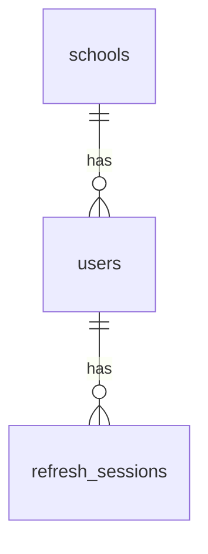

# Database Documentation

## 1. Overview

The School Management System uses PostgreSQL as its relational database.

The initial architecture uses one shared database for multiple schools. School-owned records must be associated with the appropriate school, and backend authorization must enforce tenant isolation.

**Local development database:** `school_management`

The database name is environment-specific and may differ in other deployments.

The migration SQL files in `backend/migrations/` are the authoritative definition of the intended database schema.

## 2. Current Implementation Status

The initial migrations define the following tables:

| Table | Purpose | Status |
|---|---|---|
| `schools` | Stores school records and their setup status | Created by migration v1 |
| `users` | Stores user accounts associated with schools | Created by migration v2 |
| `refresh_sessions` | Stores hashed refresh-token information and session metadata | Created by migration v2; token-family metadata added by migration v3 |

Functional tables for students, teachers, classes, subjects, attendance, transport, and other school modules are planned for future migrations.

The existence of these authentication-related tables does not mean the complete school management data model has been implemented.

## 3. Database Migrations

Migration files are stored in:

`backend/migrations/`

The migration command is located at:

`backend/cmd/migrate/`

### 3.1 Migration v1 — Schools

**Purpose:** Create the initial `schools` table.

Files:

- `000001_create_schools_table.up.sql`
- `000001_create_schools_table.down.sql`

The migration defines the initial school identity, name, code, status, and timestamp fields.

The migration SQL is authoritative for the exact column types, constraints, defaults, and indexes.

### 3.2 Migration v2 — Authentication Tables

**Purpose:** Create the initial authentication-related tables.

Files:

- `000002_create_auth_tables.up.sql`
- `000002_create_auth_tables.down.sql`

The migration creates the `users` and `refresh_sessions` tables, including their initial relationships, constraints, and indexes. The users table has a generated BIGINT identity key, a required school foreign key with `ON DELETE RESTRICT`, a non-empty username and password hash, and a status limited to `active` or `disabled`. A unique index on `(school_id, LOWER(username))` enforces case-insensitive username uniqueness within each school. This is the **current implemented schema**, not the approved target rule: Phase 1 requires globally unique, case-insensitive staff usernames. A new migration and coordinated repository/login changes are required; do not edit the already-applied v2 migration.

### 3.3 Migration v3 — Refresh-Token Families

**Purpose:** Add the `family_id` UUID used to group related refresh sessions.

Files:

- `000003_add_refresh_token_families.up.sql`
- `000003_add_refresh_token_families.down.sql`

The migration adds `family_id UUID NOT NULL DEFAULT gen_random_uuid()` and an index on `family_id`. Existing rows receive a generated UUID when the column is added. The down migration drops the family index and then the column. The v2 down migration drops `refresh_sessions` before `users`; it is destructive and permanently removes those table records. Never run destructive rollback against production without an approved backup and recovery plan.

The family identifier supports refresh-token replay handling and family-wide logout. When a previously rotated or revoked token is presented again, the application revokes the remaining active sessions in that family. The repository uses a PostgreSQL transaction advisory lock derived from the family ID to serialize refresh rotation and logout operations for the same family. Rotation additionally acquires a per-user transaction advisory lock to serialize rotations across different families belonging to the same user. It performs a fresh `FOR UPDATE` lookup after acquiring both locks before making security decisions.

### 3.4 Running Migrations

Run the migration command from the backend directory:

```bash
go run ./cmd/migrate
```

The required environment configuration and PostgreSQL database must be available before running the command.

Migrations should be applied through a controlled deployment process. Before rolling back a migration, assess its effect on existing data and application compatibility.

Never silently modify an already-applied migration to change a deployed schema. Create a new versioned migration instead.

## 4. Table: `schools`

The `schools` table represents schools registered on the platform.

The initial schema covers these fields:

| Column | Purpose |
|---|---|
| `id` | Primary key |
| `name` | School name |
| `code` | School code |
| `status` | School setup or operational status |
| `created_at` | Record creation timestamp |
| `updated_at` | Last update timestamp |

The initial supported school statuses include:

- `pending_setup`
- `active`
- `suspended`

Migration v1 defines `id BIGINT GENERATED ALWAYS AS IDENTITY PRIMARY KEY`, `name VARCHAR(150) NOT NULL`, `code VARCHAR(50) NOT NULL UNIQUE`, and `status VARCHAR(20) NOT NULL DEFAULT 'pending_setup'` constrained to `pending_setup`, `active`, or `suspended`. Both timestamps are `TIMESTAMPTZ NOT NULL DEFAULT NOW()`. The `updated_at` default initializes the field but does not automatically update it on later UPDATE statements.

### Design considerations

- School records are referenced by school-owned entities.
- Foreign keys should prevent invalid school references.
- Suspended schools must not be treated as active during authentication or authorization.
- School creation and activation workflows must be restricted to authorized operations.
- Public school onboarding must not bypass platform-level authorization.

## 5. Table: `users`

The `users` table stores accounts associated with a school.

The current migration defines the following fields:

| Column | Purpose |
|---|---|
| `id` | Primary key |
| `school_id` | Foreign key referencing `schools.id` |
| `username` | Username for the school-scoped account |
| `password_hash` | Stored password hash; must never be returned to clients |
| `status` | Account status |
| `created_at` | Record creation timestamp |
| `updated_at` | Last update timestamp |

### 5.1 Constraints and Indexes

The intended schema rules documented for the current migration include:

- `school_id` references `schools.id`.
- Deleting a referenced school is restricted by the foreign key.
- `username` must not be empty or whitespace-only.
- `password_hash` must not be empty.
- `status` is restricted to `active` or `disabled`.
- A unique index on `(school_id, LOWER(username))` currently prevents duplicates only within a school. Phase 1 target: globally unique, case-insensitive staff usernames across all schools. The migration strategy must safely detect and resolve any existing cross-school duplicates before creating the global constraint.

The migration also uses `BIGINT GENERATED ALWAYS AS IDENTITY` for the primary key and `ON DELETE RESTRICT` for the school foreign key. The case-insensitive unique index is named `users_school_username_unique`. The `updated_at` default only initializes the timestamp; it does not automatically change on UPDATE unless application code or a trigger updates it.

### 5.2 Tenant Considerations

In the current schema, every user belongs to one school through required `school_id`. Phase 1 product rules retain a strict one-school account boundary for School Admin and staff: a staff account must never be granted access to multiple schools. A person working at multiple schools must have separate accounts.

The target identity model also needs global Platform Admin identity and parent identity capable of linking to children in multiple schools. This does not mean staff receive multi-school memberships. The exact relational split between central identity, school-scoped staff account, and parent-child links is a pending schema-design decision.

The current relationship does not, by itself, enforce tenant isolation for all API operations. Backend services and repository queries must verify school ownership when accessing school-specific resources.

The current schema does not yet define the complete role and permission model required for RBAC.

### 5.3 Future User-Model Requirements

Future authentication and authorization work must consider:

- Role and permission assignments, including school-scoped custom roles and bounded per-user allow/deny overrides.
- Global Platform Admin identity, strictly one-school staff accounts, globally unique case-insensitive staff usernames, and parent identities linked to children across schools.
- Staff temporary-password activation, forced first-login change, self-service current-password verification, and admin reset with session/access revocation.
- Teacher teaching assignments separated from class-in-charge assignments, including field-level student data restrictions.
- Parent-child links and per-request relationship authorization.
- Account activation and deactivation.
- Secure password reset and password change workflows.
- MFA configuration and recovery.
- Audit logging for sensitive account and permission changes.

These are design requirements, not evidence that the corresponding database tables or columns already exist.

## 6. Table: `refresh_sessions`

The `refresh_sessions` table stores refresh-session metadata used by the authentication API.

The current schema includes the following fields:

| Column | Purpose |
|---|---|
| `id` | Primary key |
| `user_id` | Foreign key referencing `users.id` |
| `token_hash` | Hash of the opaque refresh token |
| `expires_at` | Session expiry timestamp |
| `revoked_at` | Nullable timestamp indicating revocation |
| `created_at` | Session creation timestamp |
| `family_id` | UUID grouping related refresh sessions; added by migration v3 |

The exact data types, defaults, constraints, and indexes are defined by migrations v2 and v3.

### 6.1 Constraints and Indexes

The migrations define these constraints and indexes:

- `id` is a generated identity primary key.
- `user_id` references `users(id)` with `ON DELETE CASCADE`.
- `token_hash` is `CHAR(64) NOT NULL UNIQUE`; the application stores lowercase hexadecimal SHA-256 digests, not raw refresh tokens.
- `expires_at` is required, and a check constraint requires it to be later than `created_at`.
- `revoked_at` is nullable and records revocation.
- Indexes support lookup by `user_id`, `expires_at`, and `family_id`.
- Migration v3 adds `family_id UUID NOT NULL DEFAULT gen_random_uuid()`.

`CHAR(64)` is fixed-width and PostgreSQL pads shorter values; application validation currently requires exactly 64 lowercase hexadecimal characters. Any future type change should be made through a new migration after compatibility review.

### 6.2 Refresh-Token Implementation Status

The refresh-token lifecycle is implemented in the current backend API.

The implemented workflow supports:

- Opaque random refresh-token issuance.
- SHA-256 hashing before persistence.
- Refresh-token expiry.
- Refresh-token rotation.
- Refresh-session revocation.
- Token-family replay detection.

The relevant API endpoints are:

- `POST /auth/login`
- `POST /auth/refresh`
- `POST /auth/logout`

The refresh-token lifetime is configured through `REFRESH_TOKEN_EXPIRY_DAYS`, with a default of 7 days and a supported range of 1–30 days.

When a previously rotated or revoked token is presented again, the application can revoke active sessions in the affected token family.

### 6.3 Remaining Verification

The implementation should not be considered production-ready solely because the handlers and tables exist. Remaining verification includes:

- Broader PostgreSQL-backed repository integration tests beyond the refresh-session lifecycle suite.
- Additional concurrent refresh and replay edge cases.
- More transaction-failure and database-error scenarios during rotation.
- Independent HTTP-level logout and refresh-after-logout verification.
- Migration and rollback tests against a disposable database.

Existing stateless JWT access tokens are not immediately invalidated by refresh-session logout. They can remain usable until their configured expiry unless another access-token revocation mechanism is introduced.

### 6.4 Family-level transaction coordination

`Rotate()` and `Revoke()` acquire the same PostgreSQL transaction advisory lock using `pg_advisory_xact_lock(hashtextextended(family_id, 0))`. This lock serializes operations for a token family. `Rotate()` additionally acquires a per-user transaction advisory lock, serializing concurrent rotations across that user's token families. It then reloads the session with `FOR UPDATE` before checking revocation and expiry. This coordinates refresh-vs-logout races within a family and the tested cross-family concurrent-rotation race. It does not itself coordinate external user or school status updates, and it does not revoke already-issued stateless access JWTs.

## 7. Current Relationships

The current authentication schema defines these principal relationships:



This diagram represents the intended relationships among the current tables. The migration SQL defines the actual foreign-key constraints.

The diagram does not include future relationships for students, parents, teachers, classes, attendance, or other school modules.

## 8. Database Design Principles

All new tables and migrations should follow these principles.

### 8.1 Primary Keys

Use stable primary keys to identify records.

### 8.2 Foreign Keys

Use foreign keys to preserve referential integrity and prevent invalid references.

### 8.3 Unique Constraints

Enforce uniqueness in the database when it represents a business rule. Application-level validation alone is insufficient for operations that can race.

### 8.4 Check Constraints

Use database constraints for important allowed values and data-integrity rules where appropriate.

### 8.5 Indexes

Add indexes based on query patterns and measured performance. Consider indexes on foreign keys and commonly filtered columns, while accounting for the additional storage and write cost.

### 8.6 Transactions

Use transactions when multiple database operations must succeed or fail together.

Refresh-token rotation must preserve the intended consistency between revoking the old session and creating the replacement session.

### 8.7 Parameterized Queries

Use parameterized SQL rather than concatenating untrusted input into SQL statements.

### 8.8 Timestamps

Use timezone-aware timestamps for persisted event times where appropriate. Maintain consistent UTC handling in the application.

### 8.9 Sensitive Data

Never store plaintext passwords or plaintext refresh tokens in the database.

Persist only the information required for verification and session management. Avoid logging credentials, token values, or other sensitive authentication material.

## 9. Future Schema Areas

The following areas are planned and must be modeled through reviewed migrations:

- Student records.
- Parent and guardian relationships.
- Teacher records and assignments.
- Classes and sections.
- Subjects and class-subject assignments.
- Attendance.
- Timetables.
- Transport and bus tracking.
- Notifications and reporting.
- Roles and permissions.
- MFA and recovery mechanisms.
- Audit logs.
- Password reset tokens or equivalent secure reset records.

### 9.1 Academic Structure

The default academic structure is expected to support Classes 1–12, customizable by each school.

The data model must support school-specific classes, sections, academic years, and subject assignments.

For senior classes where students can select different subjects, represent the relationships explicitly. Do not use a single JSON field as a substitute for relational entities when referential integrity and querying are required.

### 9.2 Student and Parent Relationships

Student identity should be separated from class placement or enrollment so that academic-year changes do not require creating a new student identity.

A parent or guardian may be officially linked to multiple students. The model should support many-to-many relationships and enforce authorization for every linked child.

### 9.3 Fees and Payments

Fee and payment tables are not part of the initial implementation scope unless requirements change.

## 10. Multi-Tenant Data Isolation

The shared-database strategy requires consistent isolation between schools.

Before adding a school-owned table:

1. Identify whether the entity belongs to a school.
2. Define its foreign keys and ownership rules.
3. Decide how the authorized school context reaches repository queries.
4. Ensure list, read, create, update, and delete operations enforce school ownership.
5. Add automated tests that attempt cross-school access.
6. Review joins and related-record lookups for tenant data leaks.

A `school_id` column is not sufficient unless every relevant operation enforces the correct ownership rules.

### 10.1 Required Authorization Behavior

- Derive the authenticated identity from a validated access token.
- Enforce the user's permissions on the server.
- Verify that the requested resource belongs to an authorized school.
- Never trust a client-provided `school_id` as proof of authorization.
- Ensure that update and delete operations cannot modify another school's records.
- Test direct resource lookups and indirect relationships for cross-school access.

Complete tenant-isolation enforcement remains pending. These requirements must not be interpreted as proof that all school-specific API operations are already isolated.

## 11. Backups and Production Operations

Before production deployment:

- Define automated backup schedules.
- Restrict access to backup files.
- Encrypt backups where appropriate.
- Document retention requirements.
- Test database restoration periodically.
- Monitor database availability, connections, disk capacity, and query performance.
- Use a dedicated least-privilege database role for the application.
- Secure database connections according to the production environment.
- Define a safe process for applying schema migrations.
- Establish an incident-recovery procedure.

Production backup and recovery procedures have not yet been finalized.

## 12. Schema Verification

The following queries can be used to inspect the local PostgreSQL schema.

### 12.1 List Public Tables

```sql
SELECT table_name
FROM information_schema.tables
WHERE table_schema = 'public'
  AND table_type = 'BASE TABLE'
ORDER BY table_name;
```

### 12.2 Inspect Table Columns

For example, to inspect `users`:

```sql
SELECT
    column_name,
    data_type,
    is_nullable,
    column_default
FROM information_schema.columns
WHERE table_schema = 'public'
  AND table_name = 'users'
ORDER BY ordinal_position;
```

### 12.3 Inspect Foreign Keys

```sql
SELECT
    tc.table_name,
    kcu.column_name,
    ccu.table_name AS referenced_table,
    ccu.column_name AS referenced_column,
    rc.delete_rule
FROM information_schema.table_constraints AS tc
JOIN information_schema.key_column_usage AS kcu
    ON tc.constraint_name = kcu.constraint_name
   AND tc.constraint_schema = kcu.constraint_schema
JOIN information_schema.constraint_column_usage AS ccu
    ON tc.constraint_name = ccu.constraint_name
   AND tc.constraint_schema = ccu.constraint_schema
JOIN information_schema.referential_constraints AS rc
    ON tc.constraint_name = rc.constraint_name
   AND tc.constraint_schema = rc.constraint_schema
WHERE tc.constraint_type = 'FOREIGN KEY'
  AND tc.table_schema = 'public'
ORDER BY tc.table_name, kcu.column_name;
```

Migration SQL defines the intended schema, while the local database reflects the migrations actually applied. Differences must be investigated rather than assumed to be harmless.

## 13. Maintenance

When changing the database schema:

1. Add a new versioned migration instead of silently modifying an already-applied migration.
2. Include a down migration when appropriate and safe.
3. Review foreign keys, constraints, indexes, and data migration requirements.
4. Run the migration against a development database.
5. Run relevant automated tests.
6. Update this document and `PROGRESS.md`.
7. Record significant architectural decisions in `docs/ARCHITECTURE.md` when needed.
8. Update `docs/API.md` if the schema change affects API requests, responses, or behavior.
9. Update `CHANGELOG.md` when a meaningful project milestone is completed.

Never document a planned table or constraint as implemented until its migration exists and has been reviewed. Clearly distinguish the current schema from future design requirements.


## 14. Approved Phase 1 Identity and RBAC Data Requirements (Target; Not Yet Migrated)

The detailed role and permission catalogue is in `docs/PHASE1-RBAC.md`. The following logical requirements must guide future migrations. They are not current tables or implemented constraints.

### 14.1 Staff identity and username uniqueness

- School Admin and staff accounts must be scoped to exactly one school. No staff account may have multi-school membership. A person working at multiple schools receives separate accounts.
- Staff usernames must be globally unique and case-insensitive. The current v2 index `users_school_username_unique` is only school-scoped and does not satisfy this target.
- Before adding a global unique index, migration tooling must detect cross-school case-insensitive duplicates and stop safely with an actionable report; it must not silently rename accounts.
- Current login requests require `school_id`; target staff login uses globally unique username + password. This API/repository/model change must be planned together with schema migration.

### 14.2 Platform Admin and parent identities

The target model must support a global Platform Admin identity without granting staff accounts multi-school access. It must also support one verified parent mobile identity linked to multiple students in different schools. Parent-child relationships remain school-verified and are checked on every child-data request.

Do not assume a simple nullable `users.school_id` or a universal multi-school membership table is the final design. Evaluate central identity and typed/scope-specific account relationships while preserving existing user IDs and refresh-session foreign keys.

### 14.3 Roles and permissions

The target schema must support platform-defined permissions, global platform roles, school-scoped system/custom roles, role-permission mappings, user-role assignments, per-user allow/deny overrides, and audit events. Custom role creation and permission delegation must be bounded by the School Admin's authority. A staff account may have multiple roles only within its single school.

### 14.4 Teacher and parent relationships

Teaching class/subject assignments and class-in-charge assignments must be separate relationships. Class-in-charge attendance scope is limited to the exact class/section; subject teaching grants only basic student fields and assigned teaching data, not attendance automatically. Parent links must support multiple verified children across schools without creating student login accounts in Phase 1.

### 14.5 Safe migration requirements

- Preserve existing `users.id` values and `refresh_sessions.user_id` relationships where possible.
- Do not modify already-applied migrations; add new versioned migrations.
- Plan rollback and forward-recovery behavior before applying schema changes.
- Preserve refresh-token family/replay/concurrency protections during the identity refactor.
- Add clean-database migration tests and upgrade tests from the current v3 schema.


## 15. V4 Identity and RBAC Migration Draft (Not Applied)

The user approved the V4 identity/RBAC schema direction. A draft migration is present at `backend/migrations/000004_add_principal_rbac_foundation.up.sql`, with an intentionally forward-only down migration. Its design and blockers are documented in `docs/V4-IMPLEMENTATION-NOTES.md`.

The observed development database was at migration v3 with `dirty = false`: 1 school, 1 user, 4 refresh sessions, 0 active sessions, and 0 expired sessions. The user ran duplicate and canonical-username preflight checks; both returned no violations. The existing username index was `users_school_username_unique`; the refresh-session FK was `refresh_sessions_user_id_fkey` with `ON DELETE CASCADE`.

The V4 draft adds shared principals, global username uniqueness, Platform Admin and Parent subtype tables, the permission catalogue, system roles, role permissions, principal-role assignments, per-user overrides, permission delegations, principal-bound refresh sessions, MFA/OTP storage, and append-only audit events. It preserves existing `users.id`, refresh-token hashes, and token families.

**Important:** This migration has not been executed against PostgreSQL and must not yet be applied to the user's development database. The current Go code still issues user-ID JWT subjects and does not perform principal/token-version checks or RBAC evaluation. Complete and test the Go cutover plus migration tests against a disposable PostgreSQL 18 database first. The existing staff account's role must be explicitly confirmed; do not infer it from there being one user.
