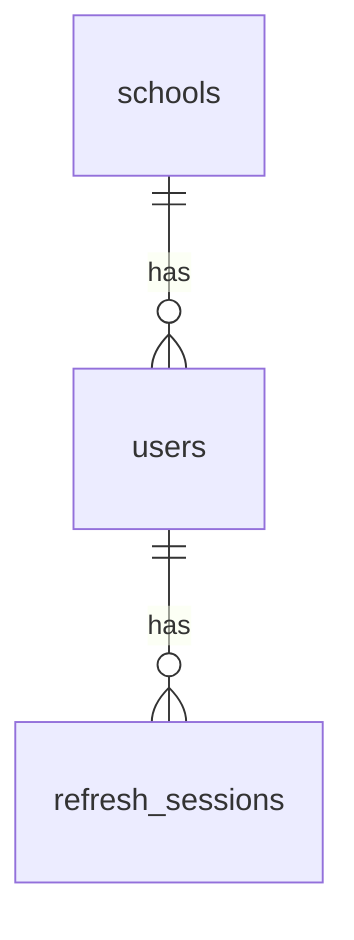

# Database Documentation

## 1. Overview

The School Management System uses PostgreSQL as its relational database.

The initial architecture uses one shared database for multiple schools. School-owned records must be associated with the appropriate school, and backend authorization must enforce tenant isolation.

**Local development database:** `school_management`

The database name is environment-specific and may differ in other deployments.

The migration SQL files in `backend/migrations/` are the authoritative definition of the intended database schema.

## 2. Current Implementation Status

The initial migrations define the following tables:

| Table | Purpose | Status |
|---|---|---|
| `schools` | Stores school records and their setup status | Created by migration v1 |
| `users` | Stores user accounts associated with schools | Created by migration v2 |
| `refresh_sessions` | Stores hashed refresh-token information and session metadata | Created by migration v2; token-family metadata added by migration v3 |

Functional tables for students, teachers, classes, subjects, attendance, transport, and other school modules are planned for future migrations.

The existence of these authentication-related tables does not mean the complete school management data model has been implemented.

## 3. Database Migrations

Migration files are stored in:

`backend/migrations/`

The migration command is located at:

`backend/cmd/migrate/`

### 3.1 Migration v1 — Schools

**Purpose:** Create the initial `schools` table.

Files:

- `000001_create_schools_table.up.sql`
- `000001_create_schools_table.down.sql`

The migration defines the initial school identity, name, code, status, and timestamp fields.

The migration SQL is authoritative for the exact column types, constraints, defaults, and indexes.

### 3.2 Migration v2 — Authentication Tables

**Purpose:** Create the initial authentication-related tables.

Files:

- `000002_create_auth_tables.up.sql`
- `000002_create_auth_tables.down.sql`

The migration creates the `users` and `refresh_sessions` tables, including their initial relationships, constraints, and indexes.

### 3.3 Migration v3 — Refresh-Token Families

**Purpose:** Add the `family_id` UUID used to group related refresh sessions.

Files:

- `000003_add_refresh_token_families.up.sql`
- `000003_add_refresh_token_families.down.sql`

The family identifier supports refresh-token replay handling. When a previously rotated or revoked token is presented again, the application can revoke the remaining active sessions in the affected family.

The exact default expression, index definition, and rollback behavior are determined by the migration SQL.

### 3.4 Running Migrations

Run the migration command from the backend directory:

```bash
go run ./cmd/migrate
```

The required environment configuration and PostgreSQL database must be available before running the command.

Migrations should be applied through a controlled deployment process. Before rolling back a migration, assess its effect on existing data and application compatibility.

Never silently modify an already-applied migration to change a deployed schema. Create a new versioned migration instead.

## 4. Table: `schools`

The `schools` table represents schools registered on the platform.

The initial schema covers these fields:

| Column | Purpose |
|---|---|
| `id` | Primary key |
| `name` | School name |
| `code` | School code |
| `status` | School setup or operational status |
| `created_at` | Record creation timestamp |
| `updated_at` | Last update timestamp |

The initial supported school statuses include:

- `pending_setup`
- `active`
- `suspended`

The exact column types, nullability, defaults, constraints, and indexes are defined in migration v1.

### Design considerations

- School records are referenced by school-owned entities.
- Foreign keys should prevent invalid school references.
- Suspended schools must not be treated as active during authentication or authorization.
- School creation and activation workflows must be restricted to authorized operations.
- Public school onboarding must not bypass platform-level authorization.

## 5. Table: `users`

The `users` table stores accounts associated with a school.

The current migration defines the following fields:

| Column | Purpose |
|---|---|
| `id` | Primary key |
| `school_id` | Foreign key referencing `schools.id` |
| `username` | Username for the school-scoped account |
| `password_hash` | Stored password hash; must never be returned to clients |
| `status` | Account status |
| `created_at` | Record creation timestamp |
| `updated_at` | Last update timestamp |

### 5.1 Constraints and Indexes

The intended schema rules documented for the current migration include:

- `school_id` references `schools.id`.
- Deleting a referenced school is restricted by the foreign key.
- `username` must not be empty or whitespace-only.
- `password_hash` must not be empty.
- `status` is restricted to `active` or `disabled`.
- A unique index on `(school_id, LOWER(username))` prevents duplicate usernames within a school regardless of letter case.

The exact constraint names and definitions must be taken from the migration SQL. Review the actual migration before changing the schema or relying on a particular constraint name.

### 5.2 Tenant Considerations

A user belongs to one school through `school_id`.

This relationship does not, by itself, enforce tenant isolation for all API operations. Backend services and repository queries must verify school ownership when accessing school-specific resources.

The current schema does not yet define the complete role and permission model required for RBAC.

### 5.3 Future User-Model Requirements

Future authentication and authorization work must consider:

- Role and permission assignments.
- Platform-level identities versus school-scoped identities.
- Account activation and deactivation.
- Secure password reset and password change workflows.
- MFA configuration and recovery.
- Audit logging for sensitive account and permission changes.

These are design requirements, not evidence that the corresponding database tables or columns already exist.

## 6. Table: `refresh_sessions`

The `refresh_sessions` table stores refresh-session metadata used by the authentication API.

The current schema includes the following fields:

| Column | Purpose |
|---|---|
| `id` | Primary key |
| `user_id` | Foreign key referencing `users.id` |
| `token_hash` | Hash of the opaque refresh token |
| `expires_at` | Session expiry timestamp |
| `revoked_at` | Nullable timestamp indicating revocation |
| `created_at` | Session creation timestamp |
| `family_id` | UUID grouping related refresh sessions; added by migration v3 |

The exact data types, defaults, constraints, and indexes are defined by migrations v2 and v3.

### 6.1 Constraints and Indexes

The documented schema rules include:

- `user_id` references `users.id`.
- Deleting a user cascades to that user's refresh-session records.
- `token_hash` is unique.
- A check constraint requires `expires_at` to be later than `created_at`.
- Indexes support relevant lookups, including user and expiry-related queries.
- `family_id` groups refresh sessions that belong to the same token family.

Confirm the exact constraint and index definitions against the migration SQL before relying on their names or implementation details.

### 6.2 Refresh-Token Implementation Status

The refresh-token lifecycle is implemented in the current backend API.

The implemented workflow supports:

- Opaque random refresh-token issuance.
- SHA-256 hashing before persistence.
- Refresh-token expiry.
- Refresh-token rotation.
- Refresh-session revocation.
- Token-family replay detection.

The relevant API endpoints are:

- `POST /auth/login`
- `POST /auth/refresh`
- `POST /auth/logout`

The refresh-token lifetime is configured through `REFRESH_TOKEN_EXPIRY_DAYS`, with a default of 7 days and a supported range of 1–30 days.

When a previously rotated or revoked token is presented again, the application can revoke active sessions in the affected token family.

### 6.3 Remaining Verification

The implementation should not be considered production-ready solely because the handlers and tables exist. Remaining verification includes:

- Broader PostgreSQL-backed repository integration tests beyond the refresh-session lifecycle suite.
- Additional concurrent refresh and replay edge cases.
- More transaction-failure and database-error scenarios during rotation.
- Independent HTTP-level logout and refresh-after-logout verification.
- Migration and rollback tests against a disposable database.

Existing stateless JWT access tokens are not immediately invalidated by refresh-session logout. They can remain usable until their configured expiry unless another access-token revocation mechanism is introduced.

## 7. Current Relationships

The current authentication schema defines these principal relationships:



This diagram represents the intended relationships among the current tables. The migration SQL defines the actual foreign-key constraints.

The diagram does not include future relationships for students, parents, teachers, classes, attendance, or other school modules.

## 8. Database Design Principles

All new tables and migrations should follow these principles.

### 8.1 Primary Keys

Use stable primary keys to identify records.

### 8.2 Foreign Keys

Use foreign keys to preserve referential integrity and prevent invalid references.

### 8.3 Unique Constraints

Enforce uniqueness in the database when it represents a business rule. Application-level validation alone is insufficient for operations that can race.

### 8.4 Check Constraints

Use database constraints for important allowed values and data-integrity rules where appropriate.

### 8.5 Indexes

Add indexes based on query patterns and measured performance. Consider indexes on foreign keys and commonly filtered columns, while accounting for the additional storage and write cost.

### 8.6 Transactions

Use transactions when multiple database operations must succeed or fail together.

Refresh-token rotation must preserve the intended consistency between revoking the old session and creating the replacement session.

### 8.7 Parameterized Queries

Use parameterized SQL rather than concatenating untrusted input into SQL statements.

### 8.8 Timestamps

Use timezone-aware timestamps for persisted event times where appropriate. Maintain consistent UTC handling in the application.

### 8.9 Sensitive Data

Never store plaintext passwords or plaintext refresh tokens in the database.

Persist only the information required for verification and session management. Avoid logging credentials, token values, or other sensitive authentication material.

## 9. Future Schema Areas

The following areas are planned and must be modeled through reviewed migrations:

- Student records.
- Parent and guardian relationships.
- Teacher records and assignments.
- Classes and sections.
- Subjects and class-subject assignments.
- Attendance.
- Timetables.
- Transport and bus tracking.
- Notifications and reporting.
- Roles and permissions.
- MFA and recovery mechanisms.
- Audit logs.
- Password reset tokens or equivalent secure reset records.

### 9.1 Academic Structure

The default academic structure is expected to support Classes 1–12, customizable by each school.

The data model must support school-specific classes, sections, academic years, and subject assignments.

For senior classes where students can select different subjects, represent the relationships explicitly. Do not use a single JSON field as a substitute for relational entities when referential integrity and querying are required.

### 9.2 Student and Parent Relationships

Student identity should be separated from class placement or enrollment so that academic-year changes do not require creating a new student identity.

A parent or guardian may be officially linked to multiple students. The model should support many-to-many relationships and enforce authorization for every linked child.

### 9.3 Fees and Payments

Fee and payment tables are not part of the initial implementation scope unless requirements change.

## 10. Multi-Tenant Data Isolation

The shared-database strategy requires consistent isolation between schools.

Before adding a school-owned table:

1. Identify whether the entity belongs to a school.
2. Define its foreign keys and ownership rules.
3. Decide how the authorized school context reaches repository queries.
4. Ensure list, read, create, update, and delete operations enforce school ownership.
5. Add automated tests that attempt cross-school access.
6. Review joins and related-record lookups for tenant data leaks.

A `school_id` column is not sufficient unless every relevant operation enforces the correct ownership rules.

### 10.1 Required Authorization Behavior

- Derive the authenticated identity from a validated access token.
- Enforce the user's permissions on the server.
- Verify that the requested resource belongs to an authorized school.
- Never trust a client-provided `school_id` as proof of authorization.
- Ensure that update and delete operations cannot modify another school's records.
- Test direct resource lookups and indirect relationships for cross-school access.

Complete tenant-isolation enforcement remains pending. These requirements must not be interpreted as proof that all school-specific API operations are already isolated.

## 11. Backups and Production Operations

Before production deployment:

- Define automated backup schedules.
- Restrict access to backup files.
- Encrypt backups where appropriate.
- Document retention requirements.
- Test database restoration periodically.
- Monitor database availability, connections, disk capacity, and query performance.
- Use a dedicated least-privilege database role for the application.
- Secure database connections according to the production environment.
- Define a safe process for applying schema migrations.
- Establish an incident-recovery procedure.

Production backup and recovery procedures have not yet been finalized.

## 12. Schema Verification

The following queries can be used to inspect the local PostgreSQL schema.

### 12.1 List Public Tables

```sql
SELECT table_name
FROM information_schema.tables
WHERE table_schema = 'public'
  AND table_type = 'BASE TABLE'
ORDER BY table_name;
```

### 12.2 Inspect Table Columns

For example, to inspect `users`:

```sql
SELECT
    column_name,
    data_type,
    is_nullable,
    column_default
FROM information_schema.columns
WHERE table_schema = 'public'
  AND table_name = 'users'
ORDER BY ordinal_position;
```

### 12.3 Inspect Foreign Keys

```sql
SELECT
    tc.table_name,
    kcu.column_name,
    ccu.table_name AS referenced_table,
    ccu.column_name AS referenced_column,
    rc.delete_rule
FROM information_schema.table_constraints AS tc
JOIN information_schema.key_column_usage AS kcu
    ON tc.constraint_name = kcu.constraint_name
   AND tc.constraint_schema = kcu.constraint_schema
JOIN information_schema.constraint_column_usage AS ccu
    ON tc.constraint_name = ccu.constraint_name
   AND tc.constraint_schema = ccu.constraint_schema
JOIN information_schema.referential_constraints AS rc
    ON tc.constraint_name = rc.constraint_name
   AND tc.constraint_schema = rc.constraint_schema
WHERE tc.constraint_type = 'FOREIGN KEY'
  AND tc.table_schema = 'public'
ORDER BY tc.table_name, kcu.column_name;
```

Migration SQL defines the intended schema, while the local database reflects the migrations actually applied. Differences must be investigated rather than assumed to be harmless.

## 13. Maintenance

When changing the database schema:

1. Add a new versioned migration instead of silently modifying an already-applied migration.
2. Include a down migration when appropriate and safe.
3. Review foreign keys, constraints, indexes, and data migration requirements.
4. Run the migration against a development database.
5. Run relevant automated tests.
6. Update this document and `PROGRESS.md`.
7. Record significant architectural decisions in `docs/ARCHITECTURE.md` when needed.
8. Update `docs/API.md` if the schema change affects API requests, responses, or behavior.
9. Update `CHANGELOG.md` when a meaningful project milestone is completed.

Never document a planned table or constraint as implemented until its migration exists and has been reviewed. Clearly distinguish the current schema from future design requirements.
