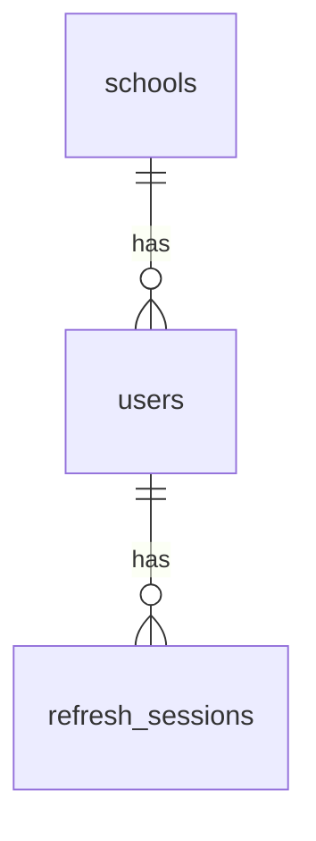

# Database Documentation

## 1. Overview

The School Management System uses PostgreSQL as its relational database.

The initial architecture uses one shared database for multiple schools. School-owned records must be associated with the appropriate school, and backend authorization must enforce tenant isolation.

**Database name in local development:** `school_management`

The database name is environment-specific and may differ in other deployments.

## 2. Current Implementation Status

The initial migrations create the following tables:

| Table | Purpose | Status |
|---|---|---|
| `schools` | Stores school records and their setup status | Implemented in migration v1 |
| `users` | Stores user accounts associated with schools | Implemented in migration v2 |
| `refresh_sessions` | Stores hashed refresh-token/session information | Schema implemented in migration v2; complete HTTP lifecycle pending |

Other functional tables, including students, teachers, classes, subjects, attendance, and transport, must be added through future migrations when their requirements and relationships are finalized.

## 3. Database Migrations

Migration files are stored in:

`backend/migrations/`

The migration command is located at:

`backend/cmd/migrate/`

### Migration v1

**Purpose:** Create the initial `schools` table.

The migration defines school identity, name, code, status, and timestamps.

### Migration v2

**Purpose:** Create the initial authentication-related tables.

Files:

- `000002_create_auth_tables.up.sql`
- `000002_create_auth_tables.down.sql`

The migration creates `users` and `refresh_sessions`, including their initial constraints and indexes.

### Running migrations

From the backend directory:

```bash
go run ./cmd/migrate
```

The required environment configuration and PostgreSQL database must be available before running the command.

Migrations should be applied through a controlled deployment process. Do not assume that a migration is safe to reverse after production data has been written.

## 4. Table: `schools`

The `schools` table represents schools registered in the platform.

The initial migration defines the following fields:

| Column | Purpose |
|---|---|
| `id` | Primary key |
| `name` | School name |
| `code` | School code |
| `status` | School setup or operational status |
| `created_at` | Record creation timestamp |
| `updated_at` | Last update timestamp |

The initial supported school statuses include:

- `pending_setup`
- `active`
- `suspended`

The exact column types, constraints, defaults, and indexes are defined by the migration SQL and are the authoritative schema definition.

### Design considerations

- School records are referenced by school-owned entities.
- Foreign keys should prevent invalid school references.
- Suspended schools must not be treated as active during authentication or authorization.
- School creation and activation workflows must be secured before public onboarding is enabled.

## 5. Table: `users`

The `users` table stores accounts associated with a school.

The current migration defines:

| Column | Purpose |
|---|---|
| `id` | Primary key |
| `school_id` | Foreign key referencing `schools.id` |
| `username` | Username for the school-scoped account |
| `password_hash` | Password hash; must never be returned to clients |
| `status` | Account status |
| `created_at` | Record creation timestamp |
| `updated_at` | Last update timestamp |

### Constraints and indexes

The documented schema rules include:

- `school_id` references `schools.id`.
- Deleting a referenced school is restricted by the foreign key.
- `username` must not be empty or whitespace-only.
- `password_hash` must not be empty.
- `status` is restricted to `active` or `disabled`.
- A unique index on `(school_id, LOWER(username))` prevents duplicate usernames within a school regardless of letter case.

Verify these rules against the actual migration SQL before changing the schema or relying on a specific constraint name.

### Tenant considerations

A user belongs to one school through `school_id`.

This relationship does not, by itself, enforce tenant isolation for all API operations. Backend services and repository queries must ensure that users cannot access records belonging to another school.

The current schema does not yet define a complete role and permission model.

## 6. Table: `refresh_sessions`

The `refresh_sessions` table stores refresh-session metadata.

The current migration defines:

| Column | Purpose |
|---|---|
| `id` | Primary key |
| `user_id` | Foreign key referencing `users.id` |
| `token_hash` | Unique hash of the refresh token |
| `expires_at` | Session expiry timestamp |
| `revoked_at` | Timestamp indicating revocation; nullable |
| `created_at` | Session creation timestamp |

### Constraints and indexes

The documented schema rules include:

- `user_id` references `users.id`.
- Deleting a user cascades to that user's refresh-session records.
- `token_hash` is unique.
- A check constraint requires `expires_at` to be later than `created_at`.
- Indexes support lookup by user and expiry timestamp.

The migration SQL is authoritative for the exact constraints and indexes.

### Important implementation note

The table exists, but a complete refresh-token lifecycle is not yet implemented in the current School Management System API.

Future authentication work must implement secure token generation, hash comparison, rotation, expiry enforcement, revocation, and concurrency-safe handling of refresh requests.

## 7. Relationships

The current schema defines these relationships:



This diagram represents the current foreign-key relationships. It does not show future relationships for students, teachers, classes, attendance, or other school modules.

## 8. Database Design Principles

New tables and migrations should follow these principles.

### Primary keys

Use stable primary keys to identify records.

### Foreign keys

Use foreign keys to preserve referential integrity and prevent invalid references.

### Unique constraints

Enforce uniqueness in the database when it represents a business rule. Application-level validation alone is insufficient for race-prone operations.

### Check constraints

Use database constraints for important allowed values and data-integrity rules where appropriate.

### Indexes

Add indexes based on query patterns and measured performance. Consider indexes on foreign keys and commonly filtered columns, but avoid unnecessary indexes that increase write and storage costs.

### Transactions

Use transactions when multiple database operations must succeed or fail together.

### Parameterized queries

Use parameterized SQL rather than concatenating untrusted input into SQL statements.

### Timestamps

Use timezone-aware timestamps for persisted event times where appropriate. Maintain consistent UTC handling in the application.

## 9. Future Schema Areas

The following areas are planned and must be modeled through reviewed migrations:

- Student records.
- Parent and guardian relationships.
- Teacher records and assignments.
- Classes and sections.
- Subjects and class-subject assignments.
- Attendance.
- Timetables.
- Transport and bus tracking.
- Notifications and reporting.

For senior classes where students can take different subjects, model the relevant relationships explicitly. Do not use a single JSON field as a substitute for relational entities when referential integrity and querying are required.

Fee and payment tables are not part of the initial implementation scope unless requirements change.

## 10. Multi-Tenant Data Isolation

The shared-database strategy requires careful isolation between schools.

Before adding school-owned tables:

1. Identify whether the entity belongs to a school.
2. Define its foreign keys and ownership rules.
3. Decide how the authorized school context reaches repository queries.
4. Ensure list, read, create, update, and delete operations enforce school ownership.
5. Add tests that attempt cross-school access.
6. Review joins and related-record lookups for tenant leaks.

A `school_id` column is not sufficient unless every relevant operation enforces the correct ownership rules.

## 11. Backups and Production Operations

Before production deployment:

- Define automated backup schedules.
- Restrict access to backup files.
- Encrypt backups where appropriate.
- Document retention requirements.
- Test database restoration periodically.
- Monitor database availability, connections, disk capacity, and query performance.
- Use a dedicated least-privilege database role for the application.
- Secure database connections according to the production environment.
- Define a safe process for applying schema migrations.

Production backup and recovery procedures have not yet been finalized.

## 12. Schema Verification

Inspect the current public tables with PostgreSQL:

```sql
SELECT table_name
FROM information_schema.tables
WHERE table_schema = 'public'
  AND table_type = 'BASE TABLE'
ORDER BY table_name;
```

Inspect columns for a specific table:

```sql
SELECT
    column_name,
    data_type,
    is_nullable,
    column_default
FROM information_schema.columns
WHERE table_schema = 'public'
  AND table_name = 'users'
ORDER BY ordinal_position;
```

The migration SQL files are the source of truth for the intended schema. A local database may differ if migrations have not been applied consistently.

## 13. Maintenance

When changing the database schema:

1. Add a new versioned migration instead of silently modifying an already-applied migration.
2. Include a down migration when appropriate and safe.
3. Review foreign keys, constraints, indexes, and data migration requirements.
4. Run the migration against a development database.
5. Run relevant automated tests.
6. Update this document and `PROGRESS.md`.
7. Record important schema decisions in `ARCHITECTURE.md` when needed.

Never document a planned table as implemented until its migration exists and has been verified.
